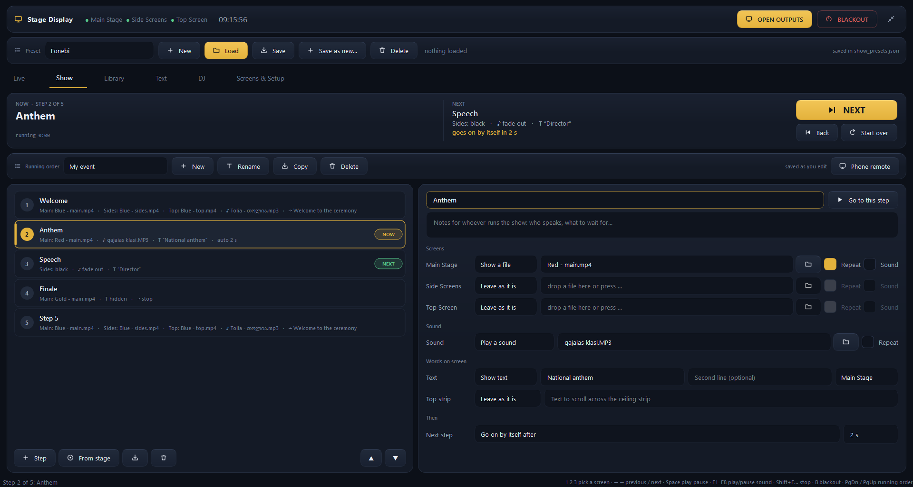
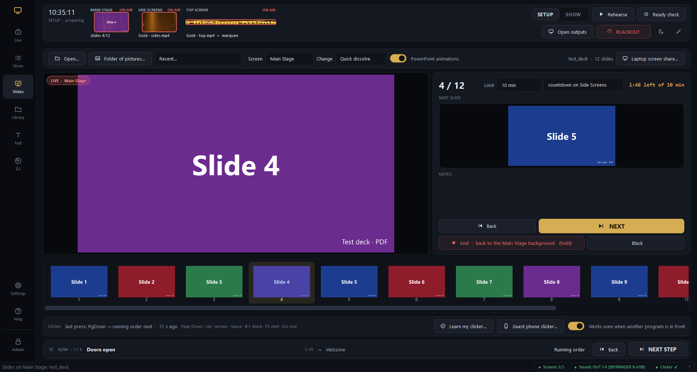

# Stage Display Controller

A multi-screen playback controller for a school assembly hall stage, written in
Python with PySide6 (Qt 6). One operator dashboard drives three stage outputs.


## The setup it drives

| Output | Screen | Notes |
| --- | --- | --- |
| **Main Stage** | large central screen | not always-on-top, so a presentation or browser can be shown over the background |
| **Side Screens** | left + right | mirrored by the video hardware, so the app renders **one** window for both |
| **Top Screen** | ceiling LED strip | background *plus* a scrolling marquee composited over it |

## Features

- **The desk** — a live picture of every stage screen in the header (red frame
  = on air), **SETUP / SHOW** modes (SHOW locks editing and deleting),
  **PREVIEW → TAKE** so nothing reaches the stage by accident, **Undo** for a
  few seconds after any change, a **Rehearse** window that tries the show out
  without touching the stage, a **Ready check** before the doors open, and
  health chips in the status bar. See [The desk](#the-desk).
- **Display routing** — assign each role to a physical monitor; the widest
  monitor is auto-detected as the ceiling strip.
- **Custom output geometry** — LED processors (Nova Studio, LVP, …) often map a
  canvas that differs from the resolution Windows reports. The ceiling strip
  reports `2816×256` but is driven at `2818×132`, so every output can be given an
  exact width/height/offset instead of plain fullscreen.
- **Playlists** — prepare several backgrounds per screen before an event, then
  switch instantly by clicking an entry or using the prev/next arrows. Entries
  are numbered and can be dragged into the running order.
- **Real video posters** — a frame is pulled out of each clip, so previews and
  playlists show the footage rather than a film icon.
- **Position bar** — elapsed / total per screen, draggable to seek, so nobody is
  guessing how long a clip has left.
- **Sound cues** — eight small players on `F1`–`F8`: play, pause, resume, stop
  and a seek bar each. Every cue has its own player, so a fanfare fires over a
  bed of music instead of interrupting it. Per-cue loop, a master level, a
  sound-device picker, and fades rather than hard cuts.
- **Keyboard control** — `1` `2` `3` pick a screen, `←` `→` step through its
  playlist, `Space` plays/pauses, `F1`–`F8` fire sound cues, `B` blacks out.
- **Text slides** — names on screen over whatever is running, prepared as a
  plain running order (one line per slide) and stepped through live. Sized to
  fit, so a long name shrinks instead of being chopped off.
- **Build a show from a folder** — point it at the event's folder and it sorts
  everything onto the right screens by shape and by name, fills the three
  playlists and the sound cues, and shows you the plan before it acts.
- **Media library** — browse the folders the event material lives in, with real
  thumbnails, a name filter and pinned folders. Send one item straight to a
  screen, fill a playlist from a multi-selection, or drop a sound onto a cue.
- **Drag & drop** everywhere; drop several files at once to fill a playlist.
- **Transitions** — a crossfade that dissolves the old picture into the new one,
  or a fade through black. Off / Fast / Normal / Slow, applied to every screen,
  to playlist steps and to blackouts.
- **Refuses bad files instead of stalling** — every file is checked before it
  reaches a screen, and anything unusable is explained in plain language with a
  suggested fix. Clips that cannot be decoded are flagged red in the playlist
  *before* the show.
- **Scaling modes** — Stretch, Fit (keep aspect), Fill (crop to cover).
- **Repeat** — on by default, per screen.
- **Marquee** — text, typeface, pixel size, colour and scroll speed, drawn over
  live video via a `QGraphicsScene`.
- **Presets** — routing, geometry, playlists, scaling, volumes and marquee
  settings saved as JSON, shown as picture tiles of what each one puts on the
  screens; the one on the screens is marked ON SCREEN (green), or CHANGED
  (amber) once edited by hand. One tap loads it with a transition on every
  screen; **Blank** clears everything for building the next show (monitor
  routing is kept — that is the hall's wiring, not the event).
- **Start with Windows** — optionally open the app at login and put a chosen
  preset on the screens, after a delay that lets LED processors finish booting.
- **Compact bar** — shrink the dashboard to a strip that floats above
  everything: which screen the arrows drive and what is on it, play/pause,
  preset, the eight cues with what is running, silence and blackout.
- **DJ desk** — two animated turntables with beat-grid waveforms, sync, loops
  and hot cues, a kill-EQ/filter/echo mixer with headphone cue and recording,
  and a synthesised techno machine (drums + acid bass) that can lock to a deck.
- **Running order** — an event as steps (screens, sound, text, marquee, notes,
  auto-advance, how long each takes), with pictures of each step's screens and
  the time the show should end, run with one NEXT button — on every tab —
  `Page Down` or a presenter clicker.
- **Slides** — PDF and PowerPoint (with its animations) straight from the app,
  with presenter view (next slide, notes, a time limit counted down), a
  clicker that works whichever window is in front, and phone pages for
  turning slides — one for the crew, a slides-only QR link for guests.
- **Laptop screen share** — any laptop on the hall's network shows its screen
  *and its sound* on the Main Stage from a web page in Chrome or Edge: nothing
  to install, the desk approves it. See [Laptop screen share](#laptop-screen-share).
- **Phone remote** — a live picture of every stage screen, NEXT, BLACKOUT,
  sound cues and presets from any phone on the Wi-Fi, behind a PIN.
- **Keeps going when something fails** — a screen whose monitor drops out comes
  back by itself, the stage is put back after a crash, and presets and running
  orders are backed up before every change. See
  [When something goes wrong](#when-something-goes-wrong).
- **Dark room** — the dashboard dims in two steps so it does not light up the
  desk in a dark hall.
- **English or Georgian** — the whole interface, phone pages included.
- **Blackout** — clears every stage screen at once.
- Stage windows are frameless, cannot be closed by the audience, and stay out of
  the taskbar (`Qt.Tool`), so only the dashboard appears there.

## Install

```
pip install PySide6 numpy
python main.py
```

Python 3.9+. Windows is the target platform; video playback uses Qt's Windows
Media Foundation backend, so codec support is whatever the machine has (H.264 /
MP4 is the safe choice).

## Running a show

1. **Screens & Setup** → assign the monitors → **Apply routing / Open outputs**.
   Use *Identify monitors* if Windows has shuffled the order.
2. Back on **Live**, drop the prepared media onto each card (or onto a screen in
   the header).
3. Try it in **Rehearse** if you like; save it as a preset so the next assembly
   is one tap away.
4. Before the doors open: **Ready check**, then switch to **SHOW**.
5. During the event, click a playlist entry (or the ◀ ▶ arrows), a preset, or
   NEXT for the running order.

The dashboard opens filling the screen and comes back the size it was left.
Applying a preset never moves or un-maximises it — that used to drag the window
to one side before every show.

`Escape` on a stage screen closes just that window; press **OPEN OUTPUTS** to
bring it back. Quitting while outputs are live asks first — closing the app
blacks out the hall.

## The desk


**The header shows the hall.** Each stage screen appears as a small live
picture of exactly what the audience sees — video, names and the ceiling
marquee included. Its frame says the state at a glance: **red = on air**, grey =
black, dashed = closed (click to open it). Drop a picture or video on a screen
there and it goes on that screen. During a PowerPoint show the tile shows the
current slide.

**SETUP / SHOW.** SETUP is for preparing: everything can be edited. SHOW is for
the event: the Library and Screens & Setup tabs step away, the running order
cannot be edited, moved or deleted, preset saving and deleting disappear, and
Rehearse and Open outputs are hidden — a stray tap cannot undo an evening's
preparation. Switching to SHOW runs the ready check and opens it if something
is wrong. The choice is remembered.

**PREVIEW → TAKE.** With it on, a file, preset or name chosen by hand does not
go on stage at once: it waits in a bar under the header with a picture of what
it is and where it goes, until **TAKE** (`Ctrl`+`Enter`) or **Cancel** (`Esc`).
Running-order steps still go straight on — NEXT is their TAKE.

**Undo.** For ten seconds after any change made by hand — a file, a preset, a
name, a screen's black button, even BLACKOUT — the bar offers **Undo**
(`Ctrl`+`Z`), which puts back exactly what was on the screens. Running-order
steps have **Back** for that.

**Rehearse** opens the three stage screens in one window on the desk, at the
stage's real sizes, scaled down. While it is open the whole dashboard drives
those instead of the stage — presets, the running order, names, slides (as
pictures, so PowerPoint never opens on the hall's screen) — and the hall keeps
what it had. Sounds started while rehearsing are silent, or go to a device you
pick (headphones); the running order gets its own music players, so the hall's
music is not faded out. **End rehearsal** gives the dashboard the stage back
exactly as it was.

**Ready check** — one page before the doors open: every screen (monitor
connected, window open, what is on it), the sound device (remember the hall's
mixer once and it warns if sound ever goes elsewhere), the master volume,
missing files in the running order and on the Live tab, the presentation, the
clicker (press it — the row turns green; presses during the check move
nothing), and the phone remote. It re-checks every second.

**Status bar.** Chips for the screens, the sound device (or *muted*), the
clicker, connected phones and missing files, coloured by how they are; a click
opens the ready check. **?** shows every keyboard shortcut.

**NOW / NEXT everywhere.** Under every tab but Show, one line carries the
running order: the step that is on, its time, the next one, Back and
**NEXT STEP**.

**Gold means the one thing to press.** Each screen has at most one gold
button — NEXT on Show and Slides, SHOW THIS NAME on Text, TAKE while a change
waits. Red is for what the audience sees (on air, BLACKOUT); green for ready
(an open window reads OPEN, a preset ON SCREEN).

**Hold to confirm.** What cannot be taken back — *Close outputs*, a preset's
*Blank* and *Delete*, and ending a presentation — acts only when held down for
a moment; a bar fills while it is held, and a quick tap does nothing.

The whole dashboard fits a 1080p desk monitor, with touch-sized controls; a
tab scrolls rather than pushing the window off the screen.

### Keys

| | |
| --- | --- |
| `1` `2` `3` | choose the screen the keyboard drives (it gets an accent border) |
| `←` `→` | previous / next entry in that screen's playlist |
| `Space` | play / pause that screen |
| `F1`–`F8` | play / pause that sound cue |
| `Shift`+`F1`–`F8` | stop it and rewind |
| `Ctrl`+`Space` | stop every sound (quick fade); *Fade out* on the Live tab takes three seconds |
| `Ctrl`+`→` / `Ctrl`+`←` | next / previous name on the Text tab |
| `Ctrl`+`H` | hide the text |
| `B` | blackout every screen (pictures only — sound keeps playing) |
| `Ctrl`+`O` | apply routing / open outputs |
| `Ctrl`+`Enter` / `Esc` | TAKE / cancel a change waiting in PREVIEW |
| `Ctrl`+`Z` | undo the last change made by hand (for ten seconds) |
| `Page Down` / `Page Up` | next / previous step of the running order — what a wireless presenter clicker sends; while slides are on screen, next / previous slide |

While slides are on screen the clicker's other keys work as in PowerPoint:
`→` `↓` `Space` `Enter` next, `←` `↑` `Backspace` back, `B` or `.` black, `F5`
back from black, `Esc` ends the presentation (it never closes a stage screen).

## Running order (one button: NEXT)



The **Show** tab turns an event into a list of steps — *Doors open, Welcome,
Anthem, Director's speech, Awards, Closing* — and runs it with one button. Each
step says what happens, and everything it does not mention is left alone:

- **each screen** (Main, Sides, Top): show a file (repeat or play once, with or
  without the video's own sound), go black, or leave it.
- **sound**: play a file (it fades over from whatever the previous step was
  playing), fade the music out, fade out *all* sound, or leave it.
- **words on screen**: show a name (and a second line) on any screen, styled as
  on the Text tab, or hide it.
- **the ceiling marquee**: scroll a text, or stop.
- **then**: wait for NEXT, go on by itself after so many seconds, or when the
  Main Stage video or the step's sound ends.
- **notes** for whoever runs the show — who speaks, what to wait for — shown
  large under NOW.

During the event: **NEXT** (the big button, `Page Down`, a presenter clicker,
the compact bar, or the phone) runs the next step; **Back** goes one step back;
double-click any step (or *Go to this step*) jumps to it. Back and jumps land
exactly where walking there would have: the app replays what the earlier steps
set up, and leaves anything already right untouched — a background that is
already playing is not restarted, and a one-off fanfare from an earlier step is
not replayed. NOW and NEXT are shown at the top with a countdown when a step
goes on by itself; closed outputs open by themselves when a step needs them.

Each step shows small pictures of what it puts on the Main Stage and the
Side Screens, and — if given under *Takes about* — how many minutes it lasts.
The list adds the show up (*6 steps · about 1 h 05 min*) and, once it runs,
says when it should end; the NOW clock turns amber when a step runs past its
time.

**From stage** adds a step that recreates whatever is on the screens right now
— set the look up on the Live tab, capture it, name it. Steps can be reordered
(▲ ▼ or drag), duplicated and deleted, also while the show runs: NOW stays on
the step that is actually running. Running orders are saved as you edit, in
`shows.json` next to the app, and can be copied for the next event. Missing
files are flagged in the toolbar before the show, not during it.

## Slides (presentations)



The **Slides** tab shows a presentation on any stage screen without leaving the
app — no PowerPoint window on the stage, no switching programs.

- **Opens** PDF, PowerPoint (`.pptx`, `.ppt`, `.ppsx`, …) and a folder of
  pictures. PDFs are drawn by the app itself; PowerPoint files are converted by
  the PowerPoint installed on this PC — hidden slides are skipped and the
  speaker notes are kept. Without PowerPoint, save the deck as PDF.
- **Prepared in the background and cached**: a PDF's first slide is ready at
  once; a PowerPoint deck shows its slides as they convert (PowerPoint's own
  start-up takes 10–20 s the first time). Opened again, a deck is ready
  instantly. Slides are rendered at the screen's size, 1920×1080 on the Main
  Stage.
- **Presenter view**: the current slide (marked LIVE, BLACK or PREVIEW), the
  next slide, the speaker notes, a slide counter and how long the slides have
  been on screen; thumbnails of every slide — tap one to jump.
- **Show on screen** puts the slides over the screen's background with a quick
  dissolve (drawn inside the stage window, so nothing flashes between slides);
  **End** puts the background back exactly as it was. **Black** blacks out just
  that screen.
- Slides can be moved before going on screen, so the talk starts on the right
  slide.

**PowerPoint animations.** With *PowerPoint animations* ticked (the default),
a PowerPoint file goes on screen as a real PowerPoint slide show, placed exactly
on the chosen stage screen — so click animations, videos and slide transitions
play as the author made them. The app still drives it: NEXT, the clicker and the
phone play the next animation or the next slide; Back, Black, jumping to a
thumbnail and End work as before, and the presenter view follows PowerPoint
(also when someone presses keys in PowerPoint itself, or presses Esc there).
NEXT stops on the last slide instead of showing PowerPoint's "End of slide show"
screen. The dashboard keeps the focus, and a stage window kept on top steps
aside for the show and comes back after it. If PowerPoint cannot start the show,
the slides appear as pictures instead. Untick it for the picture mode; PDFs and
folders of pictures are always pictures. Once used, PowerPoint stays ready,
hidden, while the app runs — a show starts in under a second, and ending one and
starting the next straight away just works — and it closes by itself after the
app does (a PowerPoint you opened yourself is never closed).

**Time limit.** Give the talk a limit (*Limit … min*) and the desk clock
counts the time left instead of up — amber in the last two minutes, red and
counting on once over. *Countdown on …* also shows it, small in the corner of a
stage screen the speaker can see (the side screens, say). Both are remembered.

**The clicker.** Page Down / Page Up (what almost every clicker sends), the
arrows, Space and Enter turn slides; B blacks out; Esc ends. It works:

- when a **stage window** has focus as well as the dashboard;
- when **another program is in front** — while slides are on screen, the
  clicker's keys are registered with Windows for the app
  (*Works even when another program is in front*, on by default, released the
  moment the talk ends);
- with **unusual clickers**: *Learn my clicker…* asks you to press its buttons
  once and remembers whatever keys they send;
- from a **guest's phone**: *Guest phone clicker…* (see below).

The clicker bar shows the last key it received and what it did, so a dead
battery is obvious before the show. When no slides are on screen, the clicker's
forward / back walk the running order instead.

**In the running order**, a step can *start this presentation* on a chosen
screen or *end the presentation*; a later step that puts something else on that
screen takes it over.

## Phone remote

**Show → Phone remote** puts the running order on any phone or tablet on the
same Wi-Fi — nothing to install: switch it on, then scan its **QR code** with the
phone camera (or open the address it shows, for example
`http://192.168.1.23:8765`) and type the four-digit PIN once. *The QR code logs
in by itself* puts the PIN into the code as well (in the part of the link that
never leaves the phone), for the crew's own phones — anyone with a photo of that
code can run the show until *New PIN*, so it is off by default.

The page opens with **what the hall sees**: Main Stage and Side Screens side by
side with the ceiling strip under them, framed red when on air — names, marquee
and PowerPoint slides included. Moving screens refresh every second, still ones
only when they change (small JPEGs, about 13 KB each), and the pictures can be
hidden. They need the PIN like everything else; the guest link cannot see them.

- **SHOW**: NOW with the step's notes and running time, a thumb-sized **NEXT**,
  Back, Start over, and the whole running order — tap a step, then GO.
- **STAGE**: BLACKOUT, which file each screen shows, the eight sound cues
  (tap to play / pause), Silence, the master volume, and the presets.
- **SLIDES** (`/slides`, a page of its own for the presenter or whoever is
  standing in for a flat clicker battery): the current and next slide as
  pictures, the notes, the slide counter and time, a huge NEXT, Back, Black and
  Show / End. A Bluetooth clicker paired with the phone drives this page too.

**Guest phone clicker.** For a visiting speaker: *Guest phone clicker…* on the
Slides tab (or in the Phone remote window) shows a separate QR code. Scanned, it
opens just the slides — current and next slide, notes, NEXT and Back — with no
PIN and nothing else: no Black, no Show / End, no screens, sound, presets or
running order; the server refuses anything but turning slides from that link.
*New link* retires the old code at once (its page then says the link has
expired), and the guest link can be switched off. It switches the phone remote
on if it was off.

It is off until switched on, and it stays on across restarts once it is. Every
request needs the PIN; *New PIN* locks out phones that knew the old one; an
address that gets the PIN wrong five times is locked out for a minute. A double
tap on NEXT cannot skip a step. The first time it is switched on, Windows asks
whether Python may use the network — allow it on private networks. The page can
be added to the phone's home screen as a shortcut.

## Laptop screen share

**Slides → Laptop screen share…** switches it on and shows what the laptop
needs: an address such as `https://192.168.1.23:8443` (also as a QR code) and a
four-digit share code.

On the laptop, in **Chrome or Edge**:

1. Open the address. The first time, the browser warns that the connection is
   not private — the app signs its own certificate, because a hall PC has no
   domain name a certificate authority would sign. Press *Advanced → Continue*.
2. Type the code (and a name, so the desk knows who is asking), pick *Slides
   and documents* (sharper text) or *Video* (smoother movement), press **Share
   my screen**.
3. In the browser's window choose *Entire screen* and switch on **Also share
   system audio** — or choose a tab and *Also share tab audio*. The page says
   whether sound is being sent.

At the desk a bar appears over every tab: *“Nino wants to share their screen”*
with **Show on Main Stage** and **Decline**. Nothing reaches the stage until the
operator presses it (for rehearsals, *Put a laptop on stage as soon as it asks*
skips that). On stage, the bar shows who is on, the resolution and frame rate,
whether sound is arriving, a volume slider for the hall, and **Stop sharing**.
A second laptop can ask meanwhile; showing it takes the first one off.

The laptop's picture lies over the Main Stage window, so ending the share simply
uncovers what was there. It ends when the laptop stops (or closes the tab), when
the desk presses Stop, on **BLACKOUT**, when the Main Stage is sent something
new (a step, a preset, a file — text and the speaker's timer laid over it do
not count), when the Main Stage window closes, or when the connection drops for
more than a few seconds. The laptop's page always says why. The header's
picture of the Main Stage, and the phone remote's, show the laptop while it is on.

How it works: the page captures the screen with `getDisplayMedia` and sends it
over **WebRTC** straight across the LAN — about a second to connect, full frame
rate, up to 8 Mbit/s for the picture and 256 kbit/s stereo Opus for the sound
(echo cancelling and noise suppression off, for music). The app plays it in
Chromium (QtWebEngine) inside the Main Stage window, through the PC's default
sound device — the hall mixer. The offer and answer travel through a small
HTTPS server on a thread of its own (`screenshare.py`); `http://` on the same
port is redirected to `https://`. The certificate is made by `selfcert.py` in
pure Python (RSA-2048, SHA-256, the PC's addresses in the subjectAltName) and
kept in `share_cert/` until the PC's address changes.

A wrong code five times locks that address out for a minute. Firefox and Safari
share the picture without sound. On a Mac, share a Chrome tab to send its sound.

## Building a show from a folder


An event's material already lives in one folder — the backgrounds, the clips,
the fanfares. **Library → Build a show from a folder…** reads that folder,
works out where each file belongs, and fills the three playlists and the sound
cues in one step.

It decides by two things:

- **Name.** Any word in the file name or the folders under the event that says
  where it goes — `top`, `zeda`, `ზედა`, `ceiling`, `strip`, `ჭერ` for the
  ceiling; `side`, `gverd`, `გვერდ` for the sides; `main`, `ცენტრ` for the
  middle. A folder called `Top` does it too.
- **Shape.** Failing a name, the pixels decide: `≥ 4:1` is the ceiling strip,
  anything taller than it is wide goes to the mirrored side screens, the rest to
  the main screen, and audio becomes a sound cue.

Name beats shape on purpose: a 1280×720 clip called
`ლაზერების ფონი გვერდების.mp4` is 16:9 but the operator wrote "of the sides" in
its name, and meant it.

Sizes come from container metadata rather than decoded frames — six clips take
about 0.2 s — so a whole folder is sorted while you wait. Nothing is applied
until you have seen the list, and every row has a dropdown to move it or skip
it.

## The compact bar


The ⤡ button in the header shrinks the dashboard to this strip, which stays on
top of whatever else is running and can be dragged anywhere. It carries only
what gets used under pressure: pick a preset and load it, step the running
order, fire the eight cues, silence the sound, blackout. Cue buttons light green
while playing and gold while paused, exactly as the full pads do. ⤢ brings the
dashboard back where it was.

## Sound

The desk sits along the bottom of the Live tab rather than behind a tab of its
own: during a ceremony the operator changes a background and fires a fanfare in
the same minute, and looking away from the screens is exactly the wrong thing to
ask for. Drop a sound file on a pad, or click an empty one to browse.

Each pad is a small player — play/pause, stop, elapsed and remaining, and a bar
you can drag to move through the sound. `F1` plays and pauses; `Shift`+`F1`
stops and rewinds. Clicking the pad body plays or pauses too, because during a
ceremony that is the fast path.

Each cue owns a separate `QMediaPlayer`, which is what lets a fanfare play over
music. Pausing and stopping animate the level to zero first
(`QAudioOutput.volume`) and starting fades up — a PA cut dead is far more
noticeable than the sound itself. Blackout is deliberately visual only;
`Ctrl`+`Space` is the sound equivalent.

Next to the output picker, **what is playing and how long it has left**, in
large type — the sound that ends soonest, amber in its last ten seconds — and
**Fade out**, a gentle three-second fade of everything, beside the quicker
**STOP SOUND**.

**Output device** picks which sound card everything plays through — cues *and*
video audio. On a hall PC feeding a mixing console this matters: the default
Windows device is rarely the one going to the PA.

## Text slides


Built for award ceremonies. The running order is a plain text box, one slide per
line, because the list already exists in a document and can be pasted straight
in; a line may carry a second, smaller line after `|`. Click a slide, or use
`Ctrl`+`→`, and it appears on the chosen screen.

**Looks**: ready-made ones — a lower third (name and role, low), a big centred
title, a gold award name, a caption at the top — set size, position, colours and
the shade in one go; *Save look…* keeps your own. **Preview** shows the selected
name at the chosen screen's real shape, drawn by the same machinery as the
stage over a live picture of what that screen shows now — so a name that is
too long, or unreadable over the footage, is seen before it goes up.

The text is drawn into the same `QGraphicsScene` as the background, so it
composites over live video — the reason the outputs stopped using `QVideoWidget`.
A dark band behind it keeps it readable over busy footage, and anything wider
than the screen is scaled down rather than clipped at the edges. Clearing a
screen takes the text with it, so a blackout cannot leave a name floating.

## Library


Pin the folders an event's material lives in and they stay in the picker. The
grid shows what each file actually is — a frame pulled from every clip, the
picture itself for images — on fixed-size tiles so the rows stay even whatever
shape the media is, including the 2816×128 strips cut for the ceiling.

Selecting one item enables **Show now on**; selecting several enables **Add to
playlist**, which is how an event gets prepared. Sound files offer the cue slots
instead, and the buttons that do not apply are simply disabled. Files can also
be dragged straight onto a screen in the header, or onto a card.

**☆ Favourite** keeps the selected files under **★ Favourites** at the top of
the folder picker, whichever folder they live in — the handful of backgrounds
used at every assembly, one click away.

## Transitions


Set the length and style in **Screens & Setup → Transition**.

**Crossfade** takes a still of what is on screen, swaps the media behind it, then
dissolves the still away — the hall never goes dark. This is why every output is
drawn through a `QGraphicsScene` rather than a `QVideoWidget`: a video widget
renders to its own surface, which cannot be captured, so there would be nothing
to dissolve *from*. It works for image→video, video→video and video→image alike.

**Through black** fades out, swaps while nothing is visible, and fades back in.
Blackouts always use this — there is nothing to dissolve into.

Loading a preset transitions too. A screen whose window has only just been
opened cuts straight in, because there is no previous picture to dissolve away
from.

Mechanically each output owns a black top-level window, faded with
`windowOpacity`. Two things that had to be right: the overlay is constructed
*with the output as its parent*, because an owned window stays above its owner
and setting a transient parent after the native window exists is too late; and it
mirrors the output's always-on-top flag, since a topmost window sits above a
non-topmost one whoever owns whom.

## When a file will not play

Nothing reaches a screen unchecked. `describe_media()` verifies the file exists,
is not empty, has a known extension, and — for images — actually decodes, by
reading a 32×32 version first, which catches the half-copied files that pass a
header check. Videos are matched against the containers the machine's backend
reports it can demux.

This build of Qt decodes **H.264, MPEG-1/2/4, WMV and MotionJPEG**. It cannot
decode H.265/HEVC, VP9 or AV1, and it cannot open WebM or FLV at all — those are
refused up front with the reason and a conversion recipe rather than freezing the
player. Playback errors that only surface at decode time are caught too: the
screen is cleared rather than left on a frozen half-frame.

Sound files are checked the same way, and a sound file dropped on a screen (or a picture dropped on a cue) is refused with a note saying where it does belong.

Supported image types come from `QImageReader.supportedImageFormats()` at
startup, so whatever the installed Qt can read — SVG, ICO, JFIF, TGA and the rest
— is accepted rather than rejected by a hardcoded list.

## DJ desk


A **DJ** tab with two turntables, a three-channel mixer, a techno machine and a
crate. It runs its own audio engine on a separate thread, so a busy dashboard
never makes the sound stutter, and it is only started the first time the tab
opens. The preset bar steps aside on this tab to give the desk the height; the
header, with BLACKOUT, stays.

**Loading.** Tracks are decoded in a separate process (`dj_decoder.py`) straight
into shared memory, so decoding never competes with the sound or the screen.
A deck is playable about **0.05 s** after a drop, even while the other deck and
the machine are playing; the waveform draws itself in as the file decodes, and
the tempo and beat grid follow a couple of seconds later (a 7.5-minute MP3:
~2 s). Tempo, grid and length are remembered per file, so a known track shows
its BPM at once, and a correction (×2, ÷2, "beat 1 is here") sticks for next
time. The crate lists the remembered BPM and length next to each track.

**Accuracy.** Tempo is found by autocorrelation and then refined against the
whole track by folding every onset onto the beat period: on test tracks from
87.5 to 174 BPM it lands on the exact tempo (within 0.01) and the beat grid
within 3 ms. Every track is loudness-matched on load. The waveform, turntable
and clock show what the hall is *hearing*, not what was just sent to the sound
card (about 80 ms earlier), and CUE, hot cues and loops land on that same
moment. The pill at the top left shows the sound card's lag, and turns amber if
the audio ever runs dry.

Each deck shows:

- a turntable whose record turns with the audio. Hold the record to scratch;
  drag the outer ring or use the mouse wheel to nudge the tempo.
- a scrolling three-band waveform (blue lows, gold mids, white highs) with the
  beat grid. Tap it to zoom; with the deck paused, drag it to move through the
  track. Below it, the four beats of the bar, and the whole track: tap to jump.
- a pitch fader (±8 / ±16 / ±50 %, widening by itself when SYNC needs more) and
  **SYNC**, which matches the tempo and locks the beat to the other deck, or to
  the machine.
- CUE, PLAY, four hot cues (tap to set or jump, hold or right-click to clear),
  beat loops of 1–16 beats, and 4-beat jumps.

If the detected tempo is off by an octave, tap the BPM for ×2 / ÷2, or to set
beat 1 at the current position.

**Mixer.** HI / MID / LOW with full kill, a resonant FILTER (left = low-pass,
right = high-pass), a tempo-synced ECHO send, channel faders with meters, a
crossfader, and MASTER. The EQ and filter work in the frequency domain (75 %
overlapped FFT frames), so every knob can move while a track plays without
clicks or phase smear. **REC** records the master output to
`Music\DJ Mixes\Mix <date>.wav`.

**Headphones.** Pick a second sound device under HEADPHONES. The CUE buttons
send a channel there, and CUE/MST blends cued channels with the master, so the
next track can be lined up without the hall hearing it.

**Techno machine.** A 16-step drum machine (kick, clap, hat, open hat, rim,
chord stab) with a 303-style acid bass line, all synthesised: nothing is
sampled. Tap steps on and off, hold (or right-click) for accents and — on the
acid row — slides, drag an acid step up or down (or use the wheel) to change its
note, tap a row name to mute it. It includes:

- a pattern bank: Berlin, Acid, Minimal, Detroit, Hard and Rolling.
- RANDOM, which writes a new pattern that still grooves.
- tempo with TAP, SWING, KEY, and a delay send.
- SYNC, which makes the machine follow the playing deck, so drums and acid
  lock onto a record.

The acid filter is rendered a bar at a time on a helper thread. Knob moves are
heard within about a tenth of a second. The pattern and knobs are remembered.

On the DJ tab, Space, the arrows and 1–3 stop driving the stage screens, so a
key press cannot pause a background mid-mix. BLACKOUT and the F-key sound cues
still work.

**On a touch screen** every control takes its own finger, so a scratch, a fader
move and a knob turn can happen at the same time. Knobs turn by dragging up or
down and reset with a double-tap; a long press does what right-click does with
a mouse; the crate scrolls with a flick while the mouse can still drag tracks
onto decks.

## Touch screens

**Screens & Setup → Touch screen** — *Automatic* (the default) switches to
finger-sized controls when Windows reports a touch screen; *Larger controls* and
*Mouse sizes* force it either way. It enlarges what is hard to hit with a finger
— slider handles, check boxes, scroll bars, list rows, tabs — and makes lists
scroll with a flick, while keeping every tab on one 1080p screen. Nothing that
matters is shown only on hover: the position handles are always visible and
the step-sequencer instructions are written out under the grid. Check boxes
become on/off switches, gold when on. The DJ tab picks up a change the next time
the app starts.

## Dark room

The moon button in the header dims the whole dashboard — *dim*, then *darker*,
then back — so the desk does not light up the operator and the front rows once
the hall lights go down. It is only a veil of paint over the window: clicks,
touches and keys go straight through, and the stage screens are never touched.
The choice is remembered.

## When something goes wrong

**A screen's monitor goes away** — an LED processor restarting, a loose cable:
that stage window is hidden at once (it keeps playing, unseen, instead of
landing on the desk) and put back exactly where it belongs when the monitor
returns. The routing keeps a disconnected monitor's place, a window Windows has
moved elsewhere is moved back, and the header and status bar say which monitor
is gone.

**The app crashes or the PC restarts.** What is on stage is written down every
few seconds. The next start offers it back — files, names, marquee, slides, the
running order's step — and puts it back by itself after 20 seconds if nobody
answers, for an unattended restart. A proper close offers nothing.

**A preset or running order is overwritten.** `presets.json` and `shows.json`
are copied into `backups/` before they change (at most one copy every two
minutes, the newest ten of each). **Screens & Setup → Backups** puts a copy back
with a hold to confirm; what was there is kept as a copy too.

## Language

**Screens & Setup → Language / ენა**: English or ქართული. The choice is used from
the next start — the app offers to restart at once (it still asks first if the
screens are live). Everything the operator reads is translated: tabs, buttons,
hints, messages, the ready check and the phone pages. Names, file names and
steps stay as they were typed.

The Georgian text lives in `i18n_ka.py` as one table keyed by the English text,
and `remote_ka.py` holds the phone pages' Georgian; a string with no entry
simply stays English. `tr()` in `i18n.py` looks a string up; captions that are
upper-case in English stay in ordinary letters in Georgian.

## Keeping it light

Measured on the hall PC (Python 3.12, a 7.5-minute MP3):

| | before | now |
| --- | --- | --- |
| dashboard idle, CPU | 6.6 % | 0 % |
| DJ tab idle, CPU | 31.6 % | under 1 % |
| one deck playing, CPU | 48 % | 23–28 % |
| deck + techno machine, CPU | 63 % | 38 % |
| track playable after a drop | 15.5 s | 0.04 s |
| load while the other deck plays | 11 s | 0.02 s playable, 2 s analysed |
| memory at start-up (peak) | 227 MB | 88 MB |
| memory with the DJ tab open | 410 MB | 242 MB |

What made the difference:

- **Nothing repaints unless it changed.** The sound-cue pads used to re-resolve
  the whole stylesheet four times a second; the DJ widgets now compare what
  they show before redrawing, and the DJ tab's refresh drops from 60 to 8 times
  a second when nothing is moving.
- **Silence costs nothing.** An idle deck, machine or echo skips its DSP
  entirely (0.03 ms per block instead of ~1 ms).
- **Decoding lives in another process**, so it never queues behind the sound
  and the screen for Python's lock.
- **numpy's maths library is held to one thread**; it used to reserve ~180 MB
  on import for threads the desk never uses.
- **The Library fills its thumbnails when first opened**, not at start-up.
- **Video is decoded on the graphics card** (DXVA2) where Windows offers it:
  three playing screens went from about 67 % to 47 % of a CPU core (FFmpeg
  falls back to the processor by itself).
- **Start-up 1.5 s → 0.9 s**: the stylesheet is set once, before any widget
  exists, instead of re-styling the finished window.
- **Clean cuts**: a cut or a dissolve waits for the new video's first frame, so
  no black frame shows in between.
- **Files are read ahead**: the next playlist item and the next step's files are
  pulled into the disk cache in the background, so they start at once even
  from a slow disk.

## Lighting backgrounds

`tools/make_light_backgrounds.py` renders ambient loops that match the hall's
stage lighting — soft beams swinging from the truss like the moving heads,
lit haze, drifting bokeh and glints, and flowing light ribbons for the ceiling
strip. Six moods (Blue, Red, Purple, Gold, Emerald, Party), each as three clips
cut for their screen:


| Screen | Size | Play as |
| --- | --- | --- |
| Main Stage | 1920×1080 | FIT |
| Side Screens | 512×1280 (portrait 2:5) | STRETCH |
| Top strip | 2816×128 | CROP |

```
python tools/make_light_backgrounds.py "<out folder>" [blue red ...] [--screens=main,top]
```

Every movement repeats a whole number of times in the 20-second clip, so the loop
has no visible seam. Frames are drawn with `QPainter` and encoded to H.264 through
Qt Multimedia (`QVideoFrameInput` → `QMediaRecorder`), so nothing else needs
installing. A full set of 18 clips takes about four minutes.

## Starting with Windows

**Screens & Setup → Start with Windows** ticks a per-user `HKCU\…\Run` entry
(no administrator rights, this account only) that launches:

```
pythonw.exe main.py --preset "<name>" --delay <seconds>
```

`pythonw.exe` keeps a console window off the stage. The delay matters: LED
processors and video walls often finish enumerating long after the desktop
appears, and applying the routing too early lands the outputs on the wrong
monitors — 20 seconds is a sensible starting point. Untick the box to remove the
entry. The same switches work by hand for testing.

## Layout

`main.py` is the dashboard (`ControlPanel`), presets, autostart and the
constants tests override; it takes every module's names back in, so `main.X`
still works. The rest is split by what it does:

| Module | Role |
| --- | --- |
| `config.py` | roles, media types, sizes, transitions, and the hardware-decoding switch |
| `theme.py` | palette, stylesheet (touch and language additions), `Icons` drawn with `QPainter` — no image assets |
| `i18n.py`, `i18n_ka.py` | `tr()`, the chosen language, and the Georgian table |
| `media.py` | `MediaProblem`, `describe_media` (why a file was refused, in plain language), `VideoThumbnailer`, `classify_media` / `scan_event_folder` (where each file of an event folder belongs), read-ahead |
| `outputs.py` | `MediaEngine`, `BaseOutputWindow` / `SceneOutputWindow` (frameless, un-closable, taskbar-less), `FadeOverlay`, `RehearsalMonitor` |
| `sound.py` | `SoundCue`, `SoundDeck`, `CuePad` — one sound per key, with fades and its own level |
| `cards.py` | `OutputCard`, `TopCard`, `DropZone`, `Playlist` — the Live tab |
| `library.py` | `MediaLibrary`, and `EventFolderDialog` (the plan, shown before anything is applied) |
| `textslides.py` | `TextSlides`: the running order of names, and how they are styled |
| `routing.py` | `RoutingRow`: the Screens & Setup rows |
| `minibar.py` | `MiniBar`, the floating strip the dashboard shrinks to |
| `backups.py` | the copies of `presets.json` and `shows.json` |

The DJ desk is kept apart, because it is the one part that needs numpy and is
only imported the first time its tab opens:

| Module | Role |
| --- | --- |
| `dj_engine.py` | tempo/beat analysis, decks, spectral EQ, echo, the techno machine, the audio thread, and `DecoderClient`, which drives the decoder process |
| `dj_decoder.py` | the decoder process: QAudioDecoder into shared memory, waveform levels as it goes, tempo at the end |
| `dj.py` | the DJ tab: `Platter`, `WaveDetail`, `BeatBar`, `WaveOverview`, `Knob`, `Fader`, `Meter`, `StepGrid`, deck/mixer/machine/crate views, and `TouchInput`, which gives every control touch, long-press and double-tap |

The running order and the remote are separate modules too; the dashboard
(`ControlPanel`) runs the steps and answers the phone:

| Module | Role |
| --- | --- |
| `show.py` | steps, `fold` (the state a step lands in), `ShowStore`, and the Show tab: NOW / NEXT, the step list and its editor |
| `remote.py` | `RemoteServer` (QTcpServer, PIN, lock-out, guest link), `RemoteDialog`, `GuestDialog`, and the phone pages themselves |
| `screenshare.py` | the laptop screen share: `ShareServer` (HTTPS, a thread), `ShareReceiver` (WebRTC in QtWebEngine over the Main Stage), `ShareBar`, `ShareDialog`, and the laptop's page |
| `selfcert.py` | a self-signed TLS certificate in pure Python, for the share's HTTPS |
| `presentation.py` | `Deck` (PDF via QtPdf, PowerPoint via its COM export, picture folders; cached), `Presenter`, `PowerPointShow` (a live PowerPoint slide show driven over a pipe), the Slides tab and `LearnDialog` |
| `qr.py` | a small QR code encoder (no extra packages) for the phone links |
| `desk.py` | the desk: `MultiView` / `ScreenTile`, `ModeSwitch`, `TakeBar` (preview, TAKE, undo), `ShowStrip`, `ReadyCheckDialog`, `PresetStrip`, `HealthBar`, `ShortcutsDialog`, `HoldButton`, and `PageTabs`, whose pages scroll instead of outgrowing the screen |

`presets.json` and `shows.json` are deliberately git-ignored: they hold absolute
paths to media on one particular machine.
