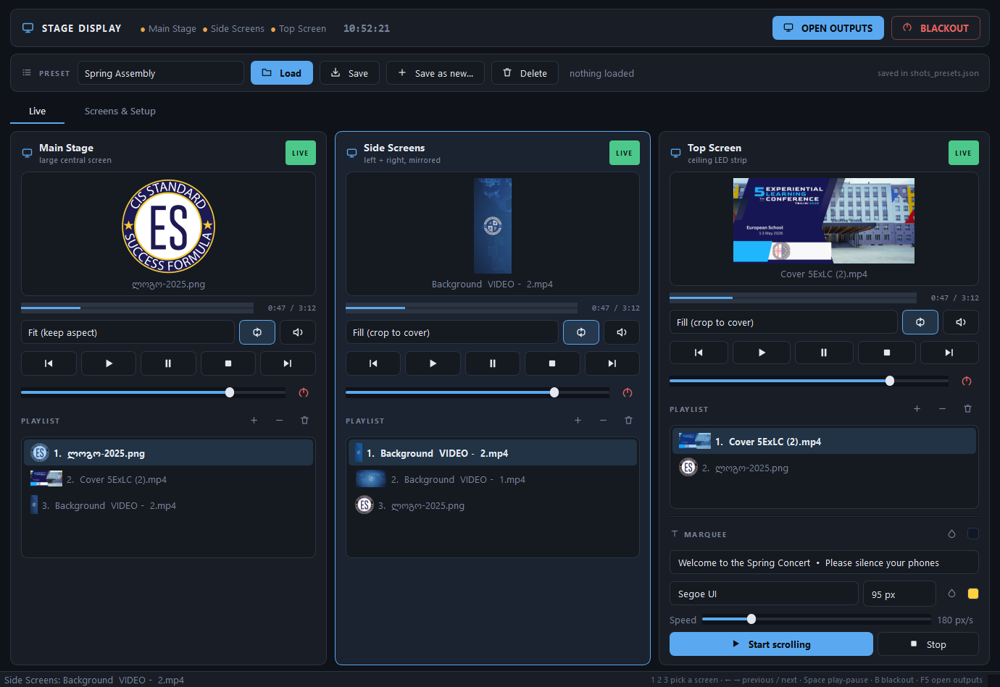
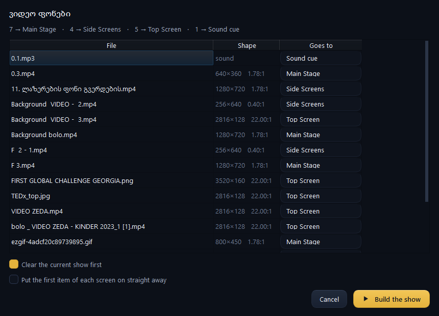
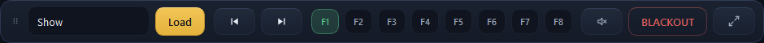
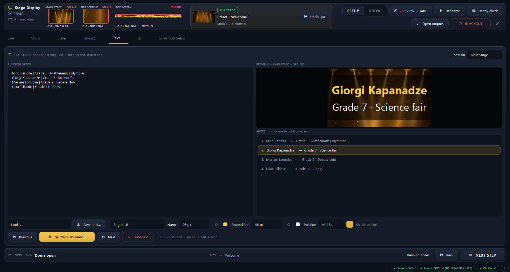
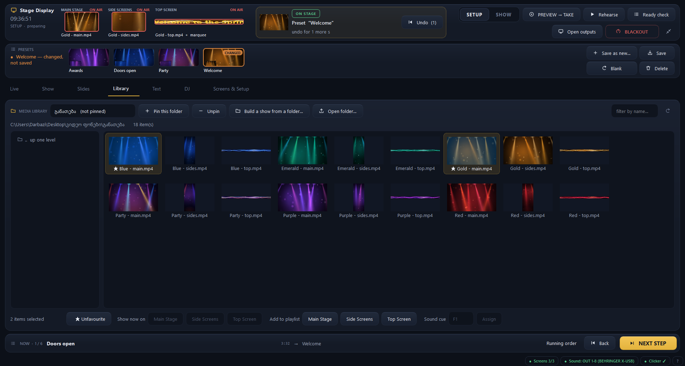
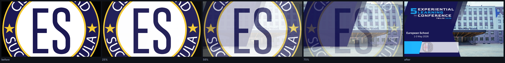
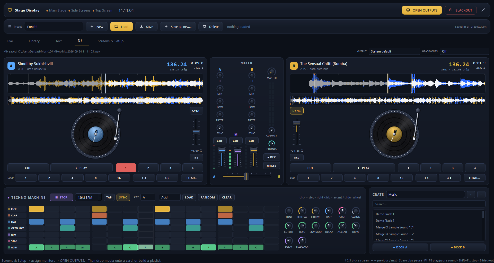
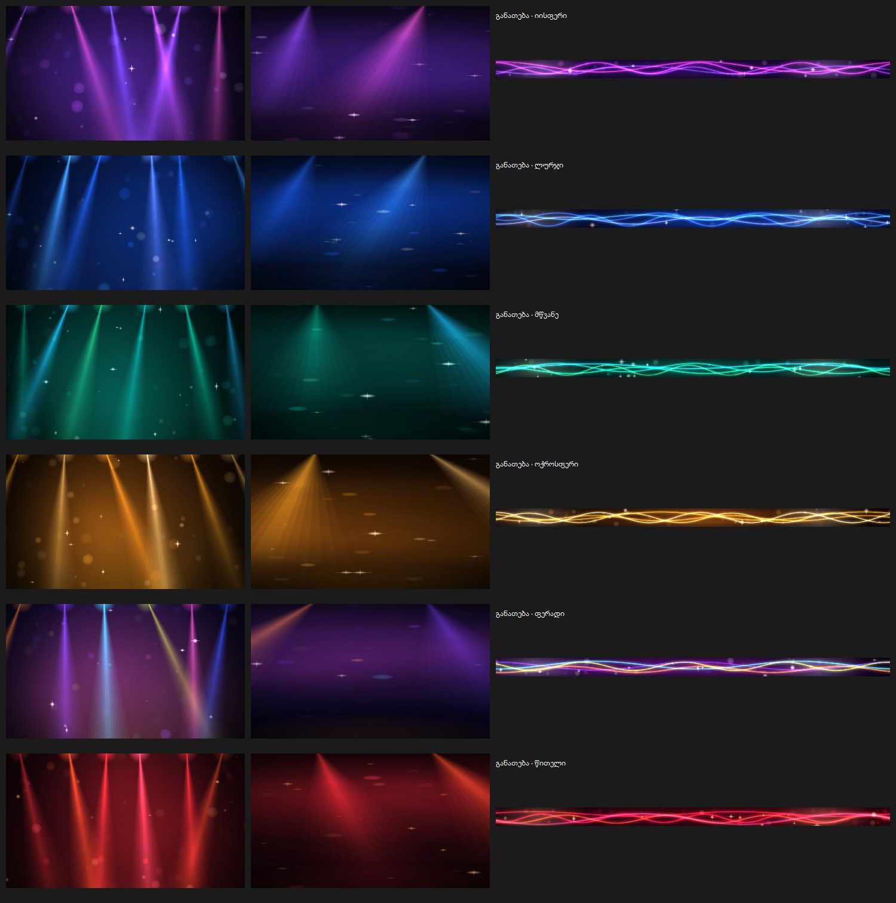

# Stage Display Controller

A multi-screen playback controller for a school assembly hall stage, written in
Python with PySide6 (Qt 6). One operator dashboard drives three stage outputs.



## The setup it drives

| Output | Screen | Notes |
| --- | --- | --- |
| **Main Stage** | large central screen | not always-on-top, so a presentation or browser can be shown over the background |
| **Side Screens** | left + right | mirrored by the video hardware, so the app renders **one** window for both |
| **Top Screen** | ceiling LED strip | background *plus* a scrolling marquee composited over it |

## Features

- **Display routing** — assign each role to a physical monitor; the widest
  monitor is auto-detected as the ceiling strip.
- **Custom output geometry** — LED processors (Nova Studio, LVP, …) often map a
  canvas that differs from the resolution Windows reports. The ceiling strip
  reports `2816×256` but is driven at `2818×132`, so every output can be given an
  exact width/height/offset instead of plain fullscreen.
- **Playlists** — prepare several backgrounds per screen before an event, then
  switch instantly by clicking an entry or using the prev/next arrows. Entries
  are numbered and can be dragged into the running order.
- **Real video posters** — a frame is pulled out of each clip, so previews and
  playlists show the footage rather than a film icon.
- **Position bar** — elapsed / total per screen, draggable to seek, so nobody is
  guessing how long a clip has left.
- **Sound cues** — eight small players on `F1`–`F8`: play, pause, resume, stop
  and a seek bar each. Every cue has its own player, so a fanfare fires over a
  bed of music instead of interrupting it. Per-cue loop, a master level, a
  sound-device picker, and fades rather than hard cuts.
- **Keyboard control** — `1` `2` `3` pick a screen, `←` `→` step through its
  playlist, `Space` plays/pauses, `F1`–`F8` fire sound cues, `B` blacks out.
- **Text slides** — names on screen over whatever is running, prepared as a
  plain running order (one line per slide) and stepped through live. Sized to
  fit, so a long name shrinks instead of being chopped off.
- **Build a show from a folder** — point it at the event's folder and it sorts
  everything onto the right screens by shape and by name, fills the three
  playlists and the sound cues, and shows you the plan before it acts.
- **Media library** — browse the folders the event material lives in, with real
  thumbnails, a name filter and pinned folders. Send one item straight to a
  screen, fill a playlist from a multi-selection, or drop a sound onto a cue.
- **Drag & drop** everywhere; drop several files at once to fill a playlist.
- **Transitions** — a crossfade that dissolves the old picture into the new one,
  or a fade through black. Off / Fast / Normal / Slow, applied to every screen,
  to playlist steps and to blackouts.
- **Refuses bad files instead of stalling** — every file is checked before it
  reaches a screen, and anything unusable is explained in plain language with a
  suggested fix. Clips that cannot be decoded are flagged red in the playlist
  *before* the show.
- **Scaling modes** — Stretch, Fit (keep aspect), Fill (crop to cover).
- **Repeat** — on by default, per screen.
- **Marquee** — text, typeface, pixel size, colour and scroll speed, drawn over
  live video via a `QGraphicsScene`.
- **Presets** — routing, geometry, playlists, scaling, volumes and marquee
  settings saved as JSON, on their own labelled row that shows which preset is
  on the screens and whether it has unsaved changes. Loading one transitions
  every screen rather than cutting, and **New** clears everything back to blank
  for building the next show (monitor routing is kept — that is the hall's
  wiring, not the event).
- **Start with Windows** — optionally open the app at login and put a chosen
  preset on the screens, after a delay that lets LED processors finish booting.
- **Compact bar** — shrink the dashboard to a strip that floats above
  everything: which screen the arrows drive and what is on it, play/pause,
  preset, the eight cues with what is running, silence and blackout.
- **DJ desk** — two animated turntables with beat-grid waveforms, sync, loops
  and hot cues, a kill-EQ/filter/echo mixer with headphone cue and recording,
  and a synthesised techno machine (drums + acid bass) that can lock to a deck.
- **Blackout** — clears every stage screen at once.
- Stage windows are frameless, cannot be closed by the audience, and stay out of
  the taskbar (`Qt.Tool`), so only the dashboard appears there.

## Install

```
pip install PySide6 numpy
python main.py
```

Python 3.9+. Windows is the target platform; video playback uses Qt's Windows
Media Foundation backend, so codec support is whatever the machine has (H.264 /
MP4 is the safe choice).

## Running a show

1. **Screens & Setup** → assign the monitors → **Apply routing / Open outputs**.
   Use *Identify monitors* if Windows has shuffled the order.
2. Back on **Live**, drop the prepared media onto each card.
3. During the event, click a playlist entry (or the ◀ ▶ arrows) to switch.
4. Save it all as a preset so the next assembly is one click away.

The dashboard opens filling the screen and comes back the size it was left.
Applying a preset never moves or un-maximises it — that used to drag the window
to one side before every show.

`Escape` on a stage screen closes just that window; press **OPEN OUTPUTS** to
bring it back. Quitting while outputs are live asks first — closing the app
blacks out the hall.

### Keys

| | |
| --- | --- |
| `1` `2` `3` | choose the screen the keyboard drives (it gets an accent border) |
| `←` `→` | previous / next entry in that screen's playlist |
| `Space` | play / pause that screen |
| `F1`–`F8` | play / pause that sound cue |
| `Shift`+`F1`–`F8` | stop it and rewind |
| `Ctrl`+`Space` | fade out every sound cue |
| `Ctrl`+`→` / `Ctrl`+`←` | next / previous name on the Text tab |
| `Ctrl`+`H` | hide the text |
| `B` | blackout every screen (pictures only — sound keeps playing) |
| `Ctrl`+`O` | apply routing / open outputs |

## Building a show from a folder



An event's material already lives in one folder — the backgrounds, the clips,
the fanfares. **Library → Build a show from a folder…** reads that folder,
works out where each file belongs, and fills the three playlists and the sound
cues in one step.

It decides by two things:

- **Name.** Any word in the file name or the folders under the event that says
  where it goes — `top`, `zeda`, `ზედა`, `ceiling`, `strip`, `ჭერ` for the
  ceiling; `side`, `gverd`, `გვერდ` for the sides; `main`, `ცენტრ` for the
  middle. A folder called `Top` does it too.
- **Shape.** Failing a name, the pixels decide: `≥ 4:1` is the ceiling strip,
  anything taller than it is wide goes to the mirrored side screens, the rest to
  the main screen, and audio becomes a sound cue.

Name beats shape on purpose: a 1280×720 clip called
`ლაზერების ფონი გვერდების.mp4` is 16:9 but the operator wrote "of the sides" in
its name, and meant it.

Sizes come from container metadata rather than decoded frames — six clips take
about 0.2 s — so a whole folder is sorted while you wait. Nothing is applied
until you have seen the list, and every row has a dropdown to move it or skip
it.

## The compact bar



The ⤡ button in the header shrinks the dashboard to this strip, which stays on
top of whatever else is running and can be dragged anywhere. It carries only
what gets used under pressure: pick a preset and load it, step the running
order, fire the eight cues, silence the sound, blackout. Cue buttons light green
while playing and gold while paused, exactly as the full pads do. ⤢ brings the
dashboard back where it was.

## Sound

The desk sits along the bottom of the Live tab rather than behind a tab of its
own: during a ceremony the operator changes a background and fires a fanfare in
the same minute, and looking away from the screens is exactly the wrong thing to
ask for. Drop a sound file on a pad, or click an empty one to browse.

Each pad is a small player — play/pause, stop, elapsed and remaining, and a bar
you can drag to move through the sound. `F1` plays and pauses; `Shift`+`F1`
stops and rewinds. Clicking the pad body plays or pauses too, because during a
ceremony that is the fast path.

Each cue owns a separate `QMediaPlayer`, which is what lets a fanfare play over
music. Pausing and stopping animate the level to zero first
(`QAudioOutput.volume`) and starting fades up — a PA cut dead is far more
noticeable than the sound itself. Blackout is deliberately visual only;
`Ctrl`+`Space` is the sound equivalent.

**Output device** picks which sound card everything plays through — cues *and*
video audio. On a hall PC feeding a mixing console this matters: the default
Windows device is rarely the one going to the PA.

## Text slides



Built for award ceremonies. The running order is a plain text box, one slide per
line, because the list already exists in a document and can be pasted straight
in; a line may carry a second, smaller line after `|`. Click a slide, or use
`Ctrl`+`→`, and it appears on the chosen screen.

The text is drawn into the same `QGraphicsScene` as the background, so it
composites over live video — the reason the outputs stopped using `QVideoWidget`.
A dark band behind it keeps it readable over busy footage, and anything wider
than the screen is scaled down rather than clipped at the edges. Clearing a
screen takes the text with it, so a blackout cannot leave a name floating.

## Library



Pin the folders an event's material lives in and they stay in the picker. The
grid shows what each file actually is — a frame pulled from every clip, the
picture itself for images — on fixed-size tiles so the rows stay even whatever
shape the media is, including the 2816×128 strips cut for the ceiling.

Selecting one item enables **Show now on**; selecting several enables **Add to
playlist**, which is how an event gets prepared. Sound files offer the cue slots
instead, and the buttons that do not apply are simply disabled.

## Transitions



Set the length and style in **Screens & Setup → Transition**.

**Crossfade** takes a still of what is on screen, swaps the media behind it, then
dissolves the still away — the hall never goes dark. This is why every output is
drawn through a `QGraphicsScene` rather than a `QVideoWidget`: a video widget
renders to its own surface, which cannot be captured, so there would be nothing
to dissolve *from*. It works for image→video, video→video and video→image alike.

**Through black** fades out, swaps while nothing is visible, and fades back in.
Blackouts always use this — there is nothing to dissolve into.

Loading a preset transitions too. A screen whose window has only just been
opened cuts straight in, because there is no previous picture to dissolve away
from.

Mechanically each output owns a black top-level window, faded with
`windowOpacity`. Two things that had to be right: the overlay is constructed
*with the output as its parent*, because an owned window stays above its owner
and setting a transient parent after the native window exists is too late; and it
mirrors the output's always-on-top flag, since a topmost window sits above a
non-topmost one whoever owns whom.

## When a file will not play

Nothing reaches a screen unchecked. `describe_media()` verifies the file exists,
is not empty, has a known extension, and — for images — actually decodes, by
reading a 32×32 version first, which catches the half-copied files that pass a
header check. Videos are matched against the containers the machine's backend
reports it can demux.

This build of Qt decodes **H.264, MPEG-1/2/4, WMV and MotionJPEG**. It cannot
decode H.265/HEVC, VP9 or AV1, and it cannot open WebM or FLV at all — those are
refused up front with the reason and a conversion recipe rather than freezing the
player. Playback errors that only surface at decode time are caught too: the
screen is cleared rather than left on a frozen half-frame.

Sound files are checked the same way, and a sound file dropped on a screen (or a picture dropped on a cue) is refused with a note saying where it does belong.

Supported image types come from `QImageReader.supportedImageFormats()` at
startup, so whatever the installed Qt can read — SVG, ICO, JFIF, TGA and the rest
— is accepted rather than rejected by a hardcoded list.

## DJ desk



A **DJ** tab with two turntables, a three-channel mixer, a techno machine and a
crate. It runs its own audio engine on a separate thread, so a busy dashboard
never makes the sound stutter, and it is only started the first time the tab
opens.

**Decks.** Drop a track on a deck, double-click it in the crate, or use LOAD….
On loading, every track is decoded, loudness-matched to the others, and
analysed for tempo and beat grid (a seven-minute MP3 takes about three
seconds). Each deck shows:

- a turntable whose record turns with the real audio position. Hold the record
  to scratch; drag the outer ring or use the mouse wheel to nudge the tempo.
- a scrolling three-band waveform (blue lows, gold mids, white highs) with the
  beat grid, and the whole track underneath: click to jump.
- a pitch fader (±8 / ±16 / ±50 %) and **SYNC**, which matches the tempo and
  locks the beat to the other deck, or to the machine.
- CUE, PLAY, four hot cues (click to set or jump, right-click to clear),
  beat loops of 1–16 beats, and 4-beat jumps.

If the detected tempo is off by an octave, right-click the BPM for ×2 / ÷2, or
set beat 1 at the current position.

**Mixer.** HI / MID / LOW with full kill, a resonant FILTER (left = low-pass,
right = high-pass), a tempo-synced ECHO send, channel faders with meters, a
crossfader, and MASTER. The EQ and filter work in the frequency domain (75 %
overlapped FFT frames), so every knob can move while a track plays without
clicks or phase smear. **REC** records the master output to
`Music\DJ Mixes\Mix <date>.wav`.

**Headphones.** Pick a second sound device under HEADPHONES. The CUE buttons
send a channel there, and CUE/MST blends cued channels with the master, so the
next track can be lined up without the hall hearing it.

**Techno machine.** A 16-step drum machine (kick, clap, hat, open hat, rim,
chord stab) with a 303-style acid bass line, all synthesised: nothing is
sampled. Click steps, right-click for accents (and slides on the acid row),
wheel on an acid step to change its note, click a row name to mute it. It
includes:

- a pattern bank: Berlin, Acid, Minimal, Detroit, Hard and Rolling.
- RANDOM, which writes a new pattern that still grooves.
- tempo with TAP, SWING, KEY, and a delay send.
- SYNC, which makes the machine follow the playing deck, so drums and acid
  lock onto a record.

The acid filter is rendered a bar at a time on a helper thread. Knob moves are
heard within about a tenth of a second. The pattern and knobs are remembered.

On the DJ tab, Space, the arrows and 1–3 stop driving the stage screens, so a
key press cannot pause a background mid-mix. BLACKOUT and the F-key sound cues
still work.

## Lighting backgrounds

`tools/make_light_backgrounds.py` renders ambient loops that match the hall's
stage lighting — soft beams swinging from the truss like the moving heads,
lit haze, drifting bokeh and glints, and flowing light ribbons for the ceiling
strip. Six moods (Blue, Red, Purple, Gold, Emerald, Party), each as three clips
cut for their screen:



| Screen | Size | Play as |
| --- | --- | --- |
| Main Stage | 1920×1080 | FIT |
| Side Screens | 512×1280 (portrait 2:5) | STRETCH |
| Top strip | 2816×128 | CROP |

```
python tools/make_light_backgrounds.py "<out folder>" [blue red ...] [--screens=main,top]
```

Every movement repeats a whole number of times in the 20-second clip, so the loop
has no visible seam. Frames are drawn with `QPainter` and encoded to H.264 through
Qt Multimedia (`QVideoFrameInput` → `QMediaRecorder`), so nothing else needs
installing. A full set of 18 clips takes about four minutes.

## Starting with Windows

**Screens & Setup → Start with Windows** ticks a per-user `HKCU\…\Run` entry
(no administrator rights, this account only) that launches:

```
pythonw.exe main.py --preset "<name>" --delay <seconds>
```

`pythonw.exe` keeps a console window off the stage. The delay matters: LED
processors and video walls often finish enumerating long after the desktop
appears, and applying the routing too early lands the outputs on the wrong
monitors — 20 seconds is a sensible starting point. Untick the box to remove the
entry. The same switches work by hand for testing.

## Layout

Everything lives in `main.py`:

| Class | Role |
| --- | --- |
| `Icons` | line icons drawn with `QPainter` — no image assets |
| `MediaEngine` | `QMediaPlayer` wrapper: looping, safe source swapping, audio |
| `SoundCue`, `SoundDeck` | one sound per key, with fade-out and its own level |
| `CuePad` | one cue as a small player: drop target, transport, seek bar |
| `BaseOutputWindow` | frameless, un-closable, taskbar-less stage window |
| `SceneOutputWindow` | any output, drawn through a `QGraphicsScene` |
| `StandardOutputWindow` / `TopOutputWindow` | Main+Sides / the ceiling strip |
| `VideoThumbnailer` | pulls one real frame out of a clip; a failure flags it as unplayable |
| `MediaProblem`, `describe_media` | why a file was refused, in plain language |
| `FadeOverlay` | crossfades or dips one output between pictures |
| `DropZone`, `Playlist` | drag & drop target and the prepared-media list |
| `MediaLibrary` | folder browser with thumbnails, feeding screens and cues |
| `TextSlides` | the running order of names, and how they are styled |
| `OutputCard`, `TopCard` | one output's live controls |
| `RoutingRow`, `PresetStore` | setup and persistence |
| `Autostart` | the per-user "run at login" registry entry |
| `classify_media`, `scan_event_folder` | where each file in an event folder belongs |
| `EventFolderDialog` | the plan, shown before anything is applied |
| `MiniBar` | the floating strip the dashboard shrinks to |
| `ControlPanel` | the dashboard |

The DJ desk is kept apart, because it is the one part that needs numpy and is
only imported the first time its tab opens:

| Module | Role |
| --- | --- |
| `dj_engine.py` | decoding, tempo/beat analysis, decks, spectral EQ, echo, the techno machine, the audio thread |
| `dj.py` | the DJ tab: `Platter`, `WaveDetail`, `WaveOverview`, `Knob`, `Fader`, `Meter`, `StepGrid`, deck/mixer/machine/crate views |

`presets.json` is deliberately git-ignored: it holds absolute paths to media on
one particular machine.
